# Asset Pipeline

한국어 | [日本語](README.ja.md)

게임에 쓸 이미지, 애니메이션, 효과음, 배경음악의 **후보**를 만드는 Python 명령줄 도구입니다.
ComfyUI 같은 생성 도구를 부르고, 결과를 자동으로 검사한 뒤, Aseprite·Godot·Phaser에서 쓸 수 있는 파일로 내보냅니다.

> **자동 승인은 없습니다.** 모든 결과는 사람이 확인하기 전까지 `REVIEW_REQUIRED`(검토 필요) 상태입니다.
> 중간에 검사에 실패하면 그 자리에서 멈추고, 실패한 기록도 지우지 않고 남깁니다.

## 무엇을 만들 수 있나

| 만드는 것 | 이름 | 상태 |
| --- | --- | --- |
| 일반 그림(캐릭터, 소품 등) | `NONPIXEL_IMAGE` | 사용 가능 |
| 일반 그림을 움직이는 애니메이션 | `NONPIXEL_ANIMATION` | 실험적, 작업 파일로만 실행 |
| 같은 인물의 표정·포즈 바꾸기 | 동일 인물 변형 | 실험적 |
| 64px 픽셀 캐릭터 | Krea2 Pixel64 | 사용 가능(`VALIDATED`) |
| 64px 픽셀 걷기·대기·공격 | Pixel64 애니메이션 | 실험적 |
| 효과음 | `SFX` | 사용 가능 |
| 효과음(rfxgen 합성) | `SFX` | 계약만 있음, 실제 실행 전 |
| 배경음악 | `BGM` | 계약만 있음, 실제 생성 전 |

## 샘플

아래는 이 도구로 만든 뒤 **사람이 확인하고 승인하거나 수용한 결과만** 모은 것입니다. 골라낸 좋은 결과이며, 생성하면 매번 이렇게 나온다는 뜻은 아닙니다.
원본 파일과 해시는 [samples.json](docs/samples/samples.json)에 기록돼 있습니다.

**일반 그림: 화풍 메뉴** (STYLE MENU 24종 중 8종. 사용자가 고른 화풍 대표 이미지이며, 애셋 승인은 아님)

<p>
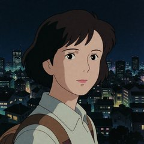


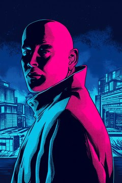
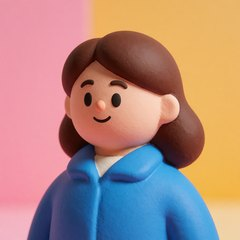
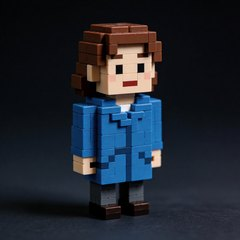
</p>

전체 24종은 [STYLE MENU v1](research/style_catalog/style_menu_v1/STYLE_MENU_v1.md)에 있습니다.

**일반 그림 애니메이션** (흰 배경 전신 1장 → 걷기 영상 1회 → 배경 제거 프레임. 사용자가 샘플로 수용함, 루프 구간 미선택·미술 승인 아님)

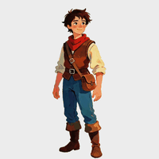

**64px 픽셀 캐릭터·소품** (Krea2 Pixel64, Aseprite 확인 후 승인, 4배 확대)

<p>
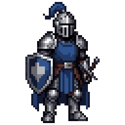
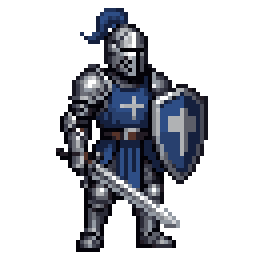
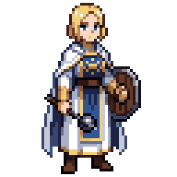
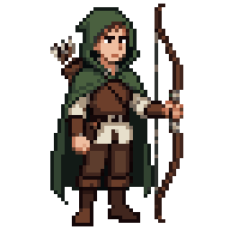


</p>

**64px 픽셀 애니메이션** (승인된 캐릭터 1장 → 동작 영상 → 프레임 선택 → 64px 변환, Aseprite 확인 후 승인)

| 기사 걷기 | 성직자 걷기 | SD 성직자 걷기 | 기사 공격 |
| :---: | :---: | :---: | :---: |
| 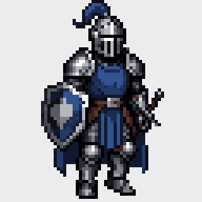 | 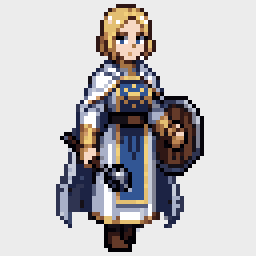 |  | 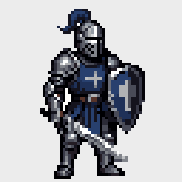 |

공격은 게임에서는 한 번만 재생됩니다. GIF에서는 잠깐 멈췄다가 다시 반복됩니다.

**동일 인물 변형** (사람이 고른 베이스 1장 → 참조 편집 1회. 사용자가 같은 인물로 수용함, 최종 미술 승인은 아님)

| 베이스 | 표정 (Grok) | 표정 (Codex) | 포즈 (Codex) |
| :---: | :---: | :---: | :---: |
|  |  |  |  |

**아직 샘플이 없는 것:** 효과음, 배경음악. README에서 바로 들을 수 없어 넣지 않았습니다.

32px 픽셀 연구는 멈춰 둔 상태입니다. 무엇을 개발하는 중인지는 [AGENTS.md](AGENTS.md),
날짜별 실험 기록은 [Factory 문서 색인](docs/factory/README.md)에 있습니다.

## 설치

필요한 것:

- Windows (다른 운영체제는 아직 확인하지 않았습니다)
- Python 3.13 권장(3.11 이상이면 설치 가능)
- ComfyUI: 그림·소리를 실제로 생성할 때 필요합니다. 기본 주소는 `http://127.0.0.1:8188`입니다.
- Aseprite: 픽셀 그림을 확인하고 내보낼 때 필요합니다.
- FFmpeg: 영상과 소리를 다룰 때 필요합니다. `PATH`에서 실행되어야 합니다.

PowerShell에서:

```powershell
git clone https://github.com/prentice7725/asset-pipeline.git
cd asset-pipeline
py -3.13 -m venv .venv
.venv\Scripts\Activate.ps1
python -m pip install -e ".[dev,motion,mcp]"
assetpipe --help
```

가상환경을 켜지 않았다면 `.venv\Scripts\assetpipe.exe`를 직접 실행하면 됩니다.
ComfyUI 주소와 제한 시간은 [config/pipeline.yaml](config/pipeline.yaml)에서 바꿉니다.
Aseprite 위치는 `ASEPRITE_PATH` 환경변수로도 지정할 수 있습니다.

## 처음 써 보기

그림 후보 하나:

```powershell
assetpipe create --type nonpixel-image --project game-a --asset-id scout --workflow anima_base --preset smoke --seed 101 --prompt "fantasy scout, short brown hair, blue cloak, light armor, dagger"
```

효과음 후보 하나(3초):

```powershell
assetpipe create --type sfx --project game-a --asset-id sword_hit --duration 3 --prompt "A single metallic sword impact, sharp clang with a short ringing decay, dry close recording, no music, no speech."
```

결과는 `workspace/<프로젝트>/runs/<애셋>/<실행ID>/`에 저장됩니다. 명령이 끝나면 `run_manifest.json` 경로를 알려 주는데,
여기에 사용한 모델, 프롬프트, seed, 검사 결과가 모두 기록됩니다. 그림은 직접 보고, 소리는 직접 들어 본 뒤 쓸지 정하세요.

## 작동 방식

```text
요청(Brief) → 어떤 workflow로 만들지 고르기 → 생성 → 자동 검사 → 사람 검토 → 승인·내보내기
```

- **Brief**: 무엇을 만들지 적은 요청서입니다. 프로젝트 문서에 근거가 있는 내용만 정본으로 다룹니다.
- **workflow**: 생성 방법 하나(모델과 설정의 묶음)입니다. 상태에 따라 쓸 수 있는 범위가 다릅니다.

| workflow 상태 | 뜻 |
| --- | --- |
| `ACTIVE` | 자동으로 골라 쓸 수 있음 |
| `VALIDATED` | 이름을 지정하면 쓸 수 있음 |
| `EXPERIMENTAL` | 이름 지정과 `--allow-experimental`이 함께 있어야 쓸 수 있음 |
| `REJECTED` | 쓸 수 없음 |

- 실패해도 **자동으로 다시 시도하거나 다른 도구로 바꾸지 않습니다.** 다시 할지는 사람이 정합니다.
- 생성 결과, 영상, 이미지는 git에 올리지 않습니다(`workspace/` 폴더는 무시됨).

## Codex·Claude Code에서 쓰기

명령을 직접 치는 대신 Codex나 Claude Code에 말로 요청할 수 있습니다. 둘 다 같은 MCP 서버를 씁니다.

1. 설정 파일을 만듭니다(이미 있으면 건너뜁니다).

   ```powershell
   Copy-Item config\mcp_adapter.example.yaml config\mcp_adapter.local.yaml
   ```

2. `source_roots`에 작업할 게임 프로젝트 폴더를 적습니다.

   ```yaml
   core_root: ..
   source_roots:
     - C:/workspace/game-a
   output_root: ../workspace/plugin_runs
   ```

3. 서버를 등록합니다. 저장소가 `C:\workspace\asset-pipeline`에 있을 때:

   ```powershell
   claude mcp add asset-pipeline --scope user -- "C:\workspace\asset-pipeline\.venv\Scripts\assetpipe-mcp.exe" --config "C:\workspace\asset-pipeline\config\mcp_adapter.local.yaml"
   ```

   ```powershell
   codex mcp add asset-pipeline -- "C:\workspace\asset-pipeline\.venv\Scripts\assetpipe-mcp.exe" --config "C:\workspace\asset-pipeline\config\mcp_adapter.local.yaml"
   ```

4. Claude Code나 Codex를 다시 시작하고 이렇게 요청합니다.

   > asset_capabilities로 준비 상태를 확인해줘.
   >
   > game-a 프로젝트에 칼 충돌 효과음을 3초로 만들어줘. 음악과 목소리는 없이.

MCP 도구는 6개입니다.

| 도구 | 하는 일 |
| --- | --- |
| `asset_capabilities` | 지금 쓸 수 있는 생성 도구와 workflow 확인 |
| `asset_build_brief` | 요청을 Brief로 정리 |
| `asset_route` | Brief에 맞는 workflow 고르기(생성 안 함) |
| `asset_generate` | 후보 생성 |
| `asset_continue_animation` | 만든 그림을 이어서 애니메이션으로 |
| `asset_inspect_run` | 실행 결과와 남은 검토 단계 확인 |

스킬까지 함께 쓰는 Claude Code 플러그인 설치, 상세 설정은 [로컬 설치 안내](docs/plugin/LOCAL_SETUP.md)와
[도구 계약](docs/plugin/MCP_TOOL_CONTRACT.md)을 보세요.

### 등록된 서버 갱신하기

등록된 `asset_pipeline` 서버는 작업 중인 폴더가 아니라, main에 합쳐진 특정 커밋의 고정 사본으로 실행됩니다.
main에 변경을 합친 뒤 다음 명령으로 갱신합니다. 생성 요청은 보내지 않습니다.

```powershell
.venv\Scripts\python workspace\mcp_runtime\redeploy.py              # origin/main으로 갱신
.venv\Scripts\python workspace\mcp_runtime\redeploy.py --status     # 지금 버전과 이전 버전
.venv\Scripts\python workspace\mcp_runtime\redeploy.py --rollback   # 이전 버전으로 되돌리기
```

갱신 후에는 열려 있는 Claude Code·Codex 세션을 다시 시작해야 새 서버를 씁니다.

## 기능별 안내

자세한 명령, 옵션, 제한은 [상세 사용 안내](docs/USAGE.md)에 있습니다.

| 하고 싶은 것 | 볼 곳 |
| --- | --- |
| 결과가 저장되는 위치를 프로젝트별로 나누기 | [프로젝트별 저장](docs/USAGE.md#프로젝트별-저장) |
| Codex CLI·Grok CLI로 그림 만들기 | [이미지 provider](docs/USAGE.md#nonpixel-이미지-provider-comfyui--codex-cli--grok-cli) |
| 256×256, 투명 배경, 용량 제한에 맞춰 받기 | [규격으로 내보내기](docs/USAGE.md#크기투명용량-규격으로-내보내기) |
| Brief 쓰기, 프롬프트 미리 보기 | [Asset Brief와 공통 프롬프트](docs/USAGE.md#asset-brief와-공통-프롬프트), [PromptSpec 안내](docs/PROMPT_SPEC.md) |
| 일반 그림을 움직이게 하기 | [넌픽셀 애니메이션](docs/USAGE.md#넌픽셀-애니메이션-명시적-모션-작업), [모션 작업 계약](docs/factory/MOTION_JOB.md) |
| 같은 인물의 표정·포즈 바꾸기 | [동일 인물 변형](docs/factory/IDENTITY_VARIANT.md) |
| 64px 픽셀 캐릭터 만들고 승인하기 | [픽셀 검증과 Static Master 승인](docs/USAGE.md#픽셀-검증과-static-master-승인) |
| 64px 픽셀 캐릭터 걷기·대기·공격 | [64px 픽셀 애니메이션](docs/USAGE.md#64px-픽셀-애니메이션-walkidleattack) |
| 효과음 | [SFX 안내](docs/SFX.md), [rfxgen 합성](docs/SFX_RFXGEN.md) |
| 배경음악 | [BGM 안내](docs/BGM.md) |
| 화풍 고르기 | [STYLE MENU v1](research/style_catalog/style_menu_v1/STYLE_MENU_v1.md) |

## 개발

```powershell
python -m pytest
assetpipe --help
```

단위 테스트에는 ComfyUI가 필요 없습니다. Aseprite가 없으면 Aseprite 테스트는 건너뜁니다.
기여 규칙은 [AGENTS.md](AGENTS.md)에 있고, 코드 구조와 실행 기록 형식은 [상세 사용 안내](docs/USAGE.md#실행-기록과-개발)에 있습니다.
외부 프로그램과 모델 가중치는 저장소에 들어 있지 않습니다.
