# STYLE MENU v1

> **2026-10-29 대표 이미지 적용:** 아래 대표 이미지는 사용자가 선택한 새 후보입니다. 파일은 로컬 `workspace/`에 보관하므로 다른 체크아웃에는 자동으로 포함되지 않습니다. [선택 목록과 SHA-256](selected_representatives.json) · [검수 기록](../../../workspace/style_menu_preflight/REFERENCE_REVIEW.md) · [이미지 모아보기](../../../workspace/style_menu_preflight/STYLE_MENU_REVIEW.html). 기존 exemplar 설정, 실패 이미지와 실험 기록은 과거 증거로 유지합니다. 메뉴 선택은 게임 에셋 또는 Aseprite 승인이 아닙니다.

> 2026-10-28: 원본 216장·run records 등 `evidence/` 폴더(227개 파일)는 저장소 용량 정리를 위해 git 이력에서 제거하고 외부에 보관합니다.
> 경로·크기·SHA256은 [external_evidence_manifest.json](external_evidence_manifest.json)과 [evidence_archive.json](evidence_archive.json)에 남아 있습니다.

24 independent operational selection units. Families are navigation only. All generated assets remain REVIEW_REQUIRED; routing authorization is distinct from Golden/Aseprite approval. No automatic fallback. STYLE-101..124 reuse benchmark contract IDs and avoid existing STYLE-001..009 collisions.

| Style | art_style | Family | Primary | Runner-up |
|---|---|---|---|---|
| STYLE-101 | 90s_nocturnal_cel | ANIME | krea2_base | anima_base_rebuilt |
| STYLE-102 | 90s_gothic_fantasy_cel | ANIME | krea2_base | anima_base_rebuilt |
| STYLE-103 | retro_sci_fi_anime | ANIME | anima_base_rebuilt | anima_turbo |
| STYLE-104 | modern_flat_manga | ANIME | krea2_base | anima_base_rebuilt |
| STYLE-105 | kawaii_pop_anime | ANIME | krea2_base | anima_base_rebuilt |
| STYLE-106 | rubber_hose_cartoon | WESTERN_CARTOON | krea2_base | anima_base_rebuilt |
| STYLE-107 | flat_western_action_cartoon | WESTERN_CARTOON | krea2_base | anima_base_rebuilt |
| STYLE-108 | graphic_novel_ink | INK_PRINT | krea2_base | anima_turbo |
| STYLE-109 | manga_screentone_noir | INK_PRINT | anima_base_rebuilt | anima_turbo |
| STYLE-110 | cozy_gouache_storybook | STORYBOOK | krea2_base | anima_base_rebuilt |
| STYLE-111 | watercolor_storybook | STORYBOOK | krea2_base | anima_base_rebuilt |
| STYLE-112 | folk_fairytale_gouache | STORYBOOK | krea2_base | anima_base_rebuilt |
| STYLE-113 | vintage_engraving | INK_PRINT | krea2_base | anima_turbo |
| STYLE-114 | impasto_painterly | PAINTERLY | krea2_base | anima_base_rebuilt |
| STYLE-115 | duotone_risograph | INK_PRINT | krea2_base | anima_base_rebuilt |
| STYLE-116 | punk_photocopy_zine | INK_PRINT | krea2_base | anima_base_rebuilt |
| STYLE-117 | flat_vector_editorial | VECTOR_EDITORIAL | unresolved | anima_turbo |
| STYLE-118 | mixed_media_collage | COLLAGE | krea2_base | anima_base_rebuilt |
| STYLE-119 | graphic_neon_cyberpunk | CYBERPUNK | anima_base_rebuilt | anima_turbo |
| STYLE-120 | inked_dark_fantasy | DARK_FANTASY | krea2_base | anima_base_rebuilt |
| STYLE-121 | clean_dreamcore_surreal | SURREAL | krea2_base | anima_turbo |
| STYLE-122 | retro_airbrush_future | AIRBRUSH | krea2_base | anima_base_rebuilt |
| STYLE-123 | clay_toy_character | CLAY_TOY | krea2_base | anima_base_rebuilt |
| STYLE-124 | voxel_diorama | VOXEL | krea2_base | anima_base_rebuilt |

Set `art_style: retro_sci_fi_anime` in a NONPIXEL_IMAGE Brief or project visual_sot.yaml (with source). The menu binds the selected style to an explicit model workflow and existing recipe/compiler. 017 requires `style_selection_policy: style_fidelity` or `character_readability`. Explicit conflicting model/workflow/style and SOT conflicts fail closed. Runner-up is reference metadata, never automatic retry/fallback.

Anima workflows remain EXPERIMENTAL in the registry. Selecting this user-authorized menu explicitly opts into its configured binding; no registry/recipe quality approvals are fabricated. Known defects become route warnings, not style holds.

Historical preview paths and evidence metadata describe the original benchmark. Newly selected representatives live in the ignored local workspace; their paths and hashes are recorded in selected_representatives.json. The historical evidence archive is external and is not bundled in this checkout.

## STYLE-101 90s nocturnal cel anime

Cel figure and complete painted night-city atmosphere

Known limitations: None recorded in this small cohort; not guaranteed


[이전 실험 대표 이미지](previews/STYLE-101_best.png) (historical)

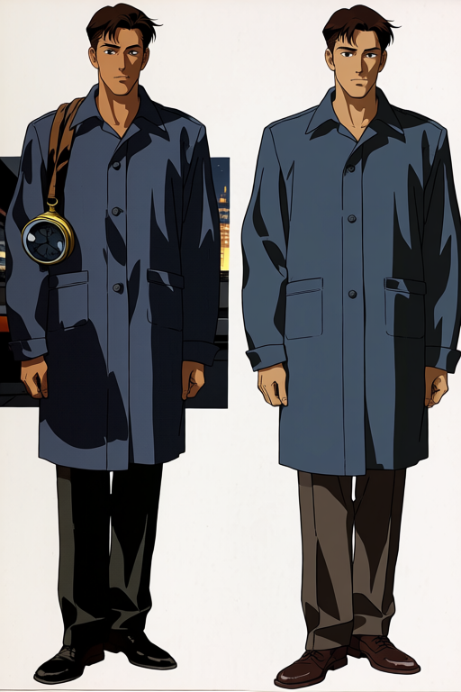

## STYLE-102 90s gothic fantasy cel

Indigo/magenta painted twilight; gothic architecture remains weak

Known limitations: None recorded in this small cohort; not guaranteed


[이전 실험 대표 이미지](previews/STYLE-102_best.png) (historical)

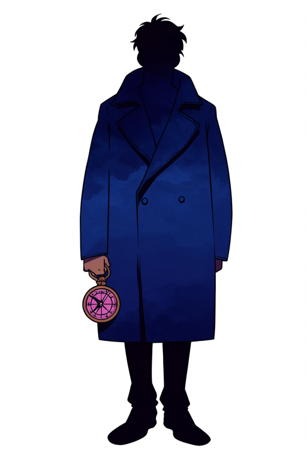

## STYLE-103 retro sci-fi anime

Richer cosmic retro anime scenery, cel shadows and neon analog mood

Known limitations: WRONG_IMAGE_SIDE


[이전 실험 대표 이미지](previews/STYLE-103_best.png) (historical)

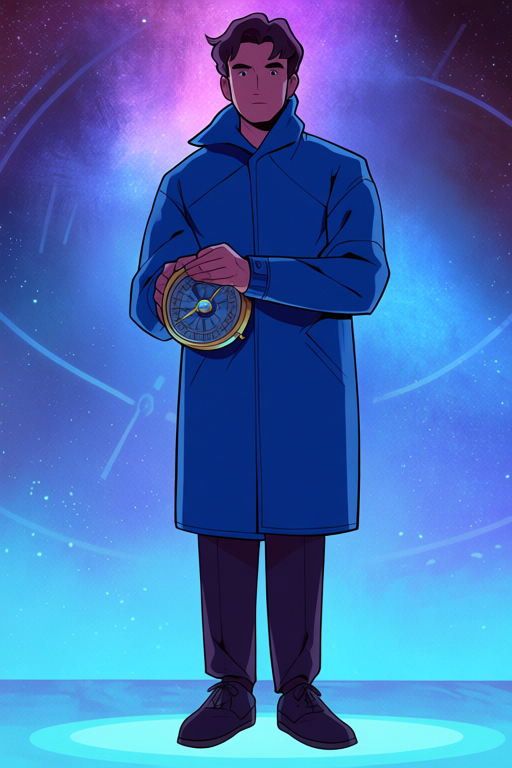

## STYLE-104 modern flat manga

Strong outlined flat manga treatment and saturated color field

Known limitations: None recorded in this small cohort; not guaranteed


[이전 실험 대표 이미지](previews/STYLE-104_best.png) (historical)

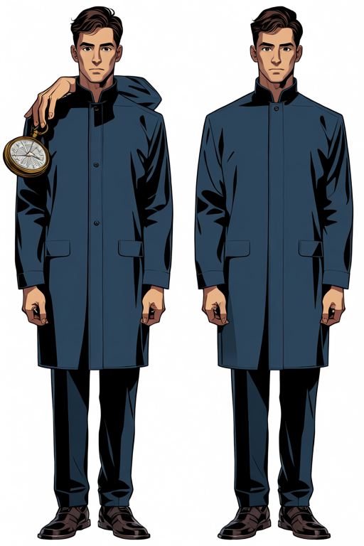

## STYLE-105 kawaii pop anime

Pastel/neon pop motifs, halftone and cute cartoon rendering

Known limitations: ADULT_APPEARANCE_UNCERTAIN


[이전 실험 대표 이미지](previews/STYLE-105_best.png) (historical)

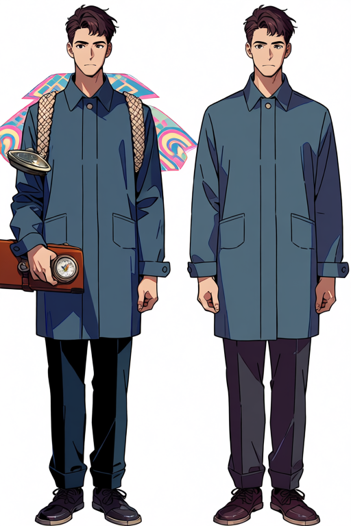

## STYLE-106 rubber-hose cartoon

Rounded cartoon/sticker language closest to rubber-hose; classic pie-eye specificity partial

Known limitations: VIEW_DRIFT, REAR_VIEW, ANATOMICAL_SIDE_NOT_VALIDATED


[이전 실험 대표 이미지](previews/STYLE-106_best.png) (historical)


## STYLE-107 flat western action cartoon

Angular geometric western-cartoon form; outlined action-cartoon specificity partial

Known limitations: FACE_READABILITY_FAILED, EQUIPMENT_CROPPED, BACKGROUND_STREAK_ARTIFACT


[이전 실험 대표 이미지](previews/STYLE-107_best.png) (historical)

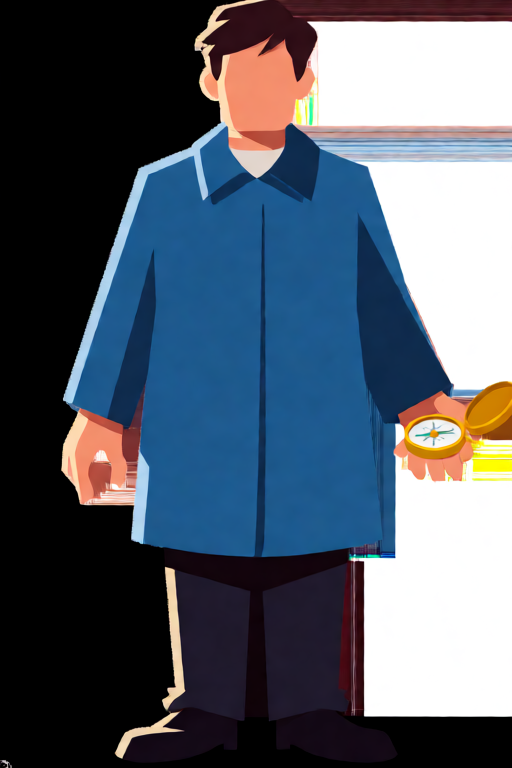

## STYLE-108 graphic novel ink

Strong cross-hatched graphic ink scene and architecture

Known limitations: EXTRA_BACKGROUND_FIGURES


[이전 실험 대표 이미지](previews/STYLE-108_best.png) (historical)

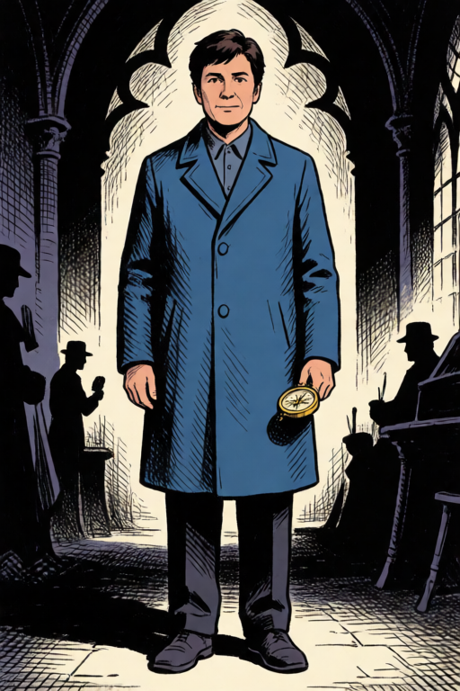

## STYLE-109 manga screentone noir

Strongest consistent coat screentone and manga ink contrast

Known limitations: WRONG_IMAGE_SIDE, FACE_DETAIL_PARTIAL


[이전 실험 대표 이미지](previews/STYLE-109_best.png) (historical)

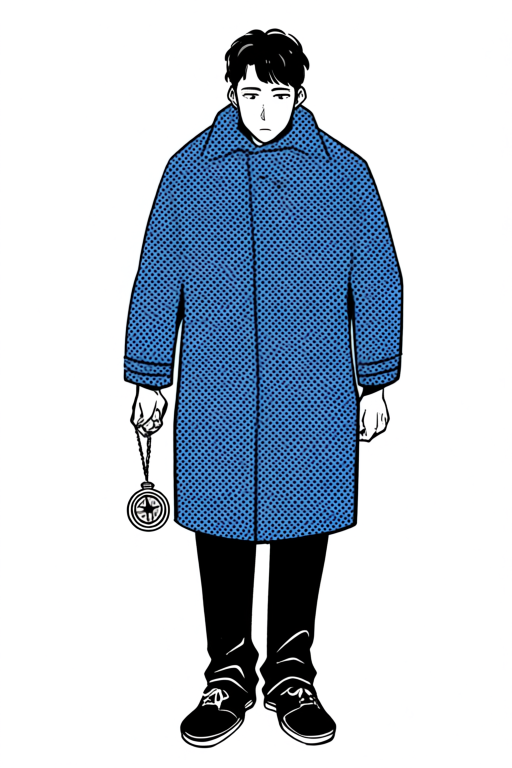

## STYLE-110 cozy gouache storybook

Opaque matte gouache brushwork shared by figure and background

Known limitations: ADULT_APPEARANCE_UNCERTAIN


[이전 실험 대표 이미지](previews/STYLE-110_best.png) (historical)

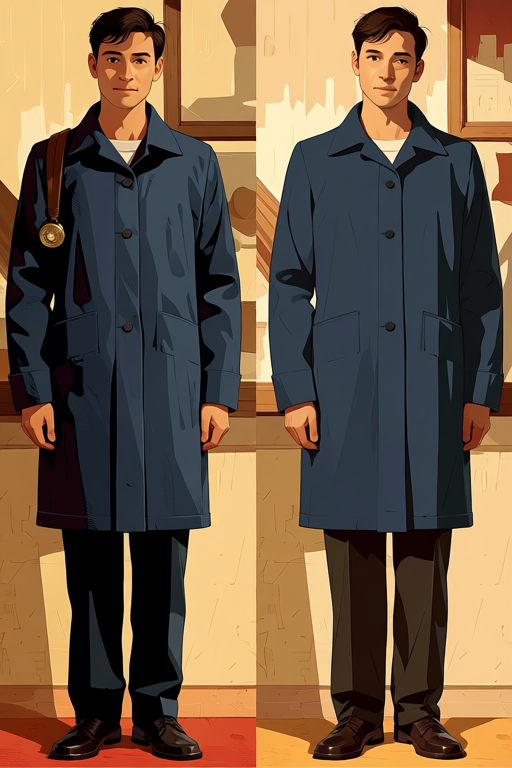

## STYLE-111 watercolor storybook

Translucent watercolor washes, delicate ink and warm paper

Known limitations: ADULT_APPEARANCE_UNCERTAIN


[이전 실험 대표 이미지](previews/STYLE-111_best.png) (historical)

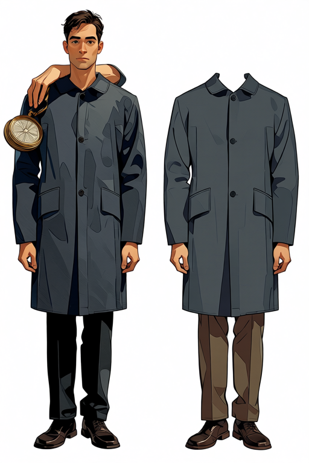

## STYLE-112 folk fairytale gouache

Folk gouache forest and warm magical glow

Known limitations: ADULT_APPEARANCE_UNCERTAIN


[이전 실험 대표 이미지](previews/STYLE-112_best.png) (historical)

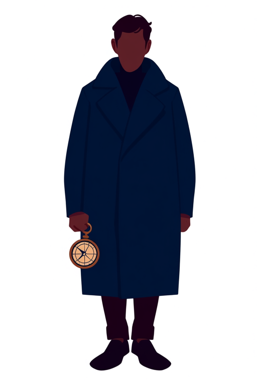

## STYLE-113 vintage engraving

Dense engraving hatching and ink portrait marks; realistic face proportions need review

Known limitations: None recorded in this small cohort; not guaranteed


[이전 실험 대표 이미지](previews/STYLE-113_best.png) (historical)

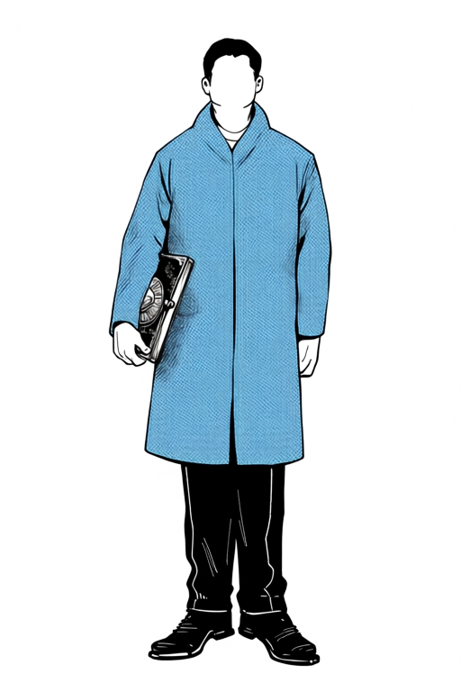

## STYLE-114 impasto painterly

Heavy impasto ridges on coat and background, muted painterly light

Known limitations: None recorded in this small cohort; not guaranteed


[이전 실험 대표 이미지](previews/STYLE-114_best.png) (historical)

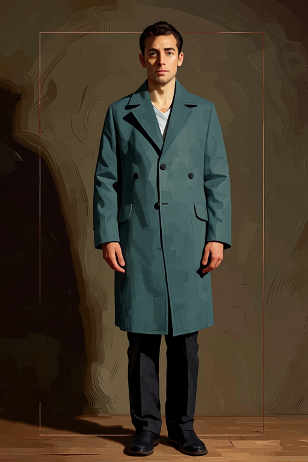

## STYLE-115 duotone risograph

Printed duotone ink, grain and offset registration clearest

Known limitations: EQUIPMENT_GEOMETRY_AMBIGUOUS


[이전 실험 대표 이미지](previews/STYLE-115_best.png) (historical)

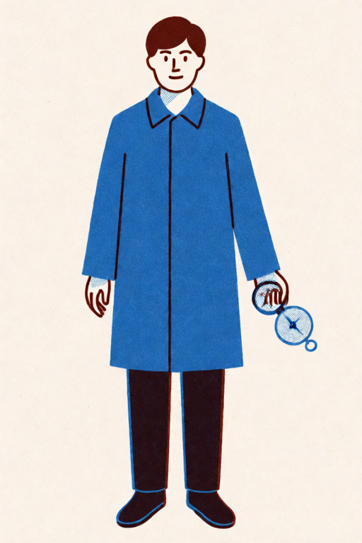

## STYLE-116 punk photocopy zine

Photocopy black/blue ink and distressed printed silhouette

Known limitations: EXTRA_CHARACTER


[이전 실험 대표 이미지](previews/STYLE-116_best.png) (historical)

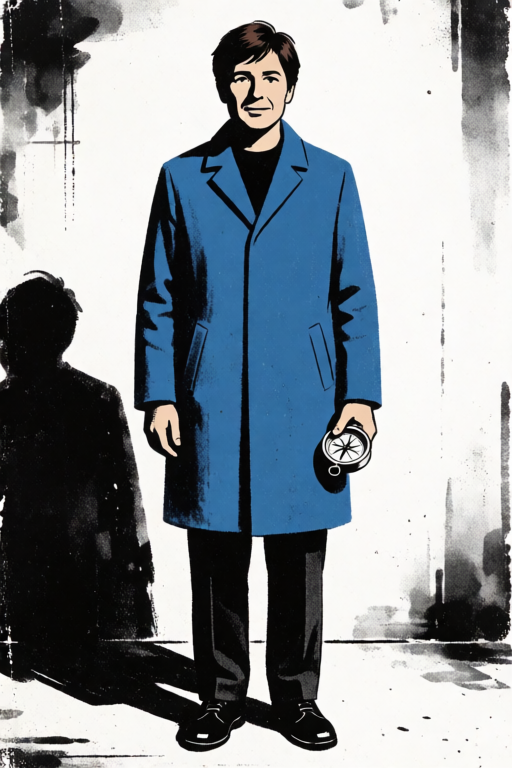

## STYLE-117 flat vector editorial

Krea best saturated minimal vector palette; Turbo readable geometric faces. Usage weighting unresolved

Known limitations: FACE_READABILITY_FAILED


[이전 실험 대표 이미지](previews/STYLE-117_best.png) (historical)

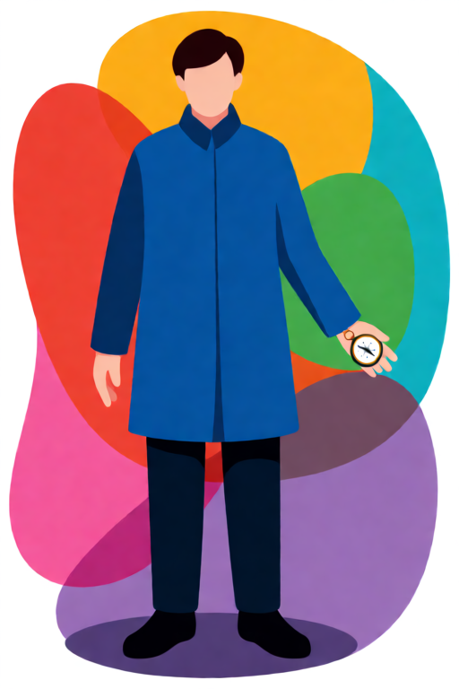

## STYLE-118 mixed-media collage

Strongest layered cut-paper offset silhouette and texture

Known limitations: FACE_READABILITY_FAILED, BACKGROUND_FIGURE_AMBIGUOUS


[이전 실험 대표 이미지](previews/STYLE-118_best.png) (historical)

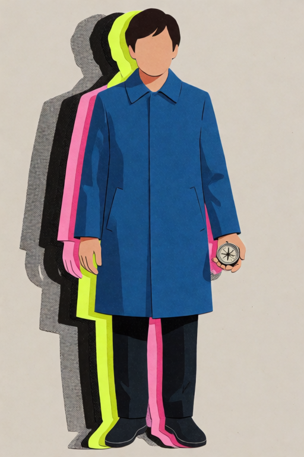

## STYLE-119 graphic neon cyberpunk

Hard graphic neon chiaroscuro and ink/halftone stronger than softer Krea paint; impasto requirement partial

Known limitations: WRONG_IMAGE_SIDE


[이전 실험 대표 이미지](previews/STYLE-119_best.png) (historical)

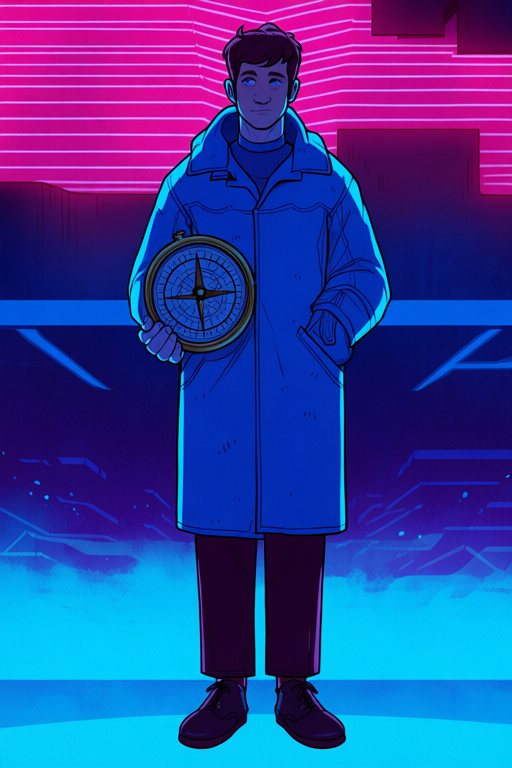

## STYLE-120 inked dark fantasy

Dark ink/wash fantasy atmosphere and background strongest

Known limitations: FACE_READABILITY_FAILED, HAIR_IDENTITY_DRIFT


[이전 실험 대표 이미지](previews/STYLE-120_best.png) (historical)

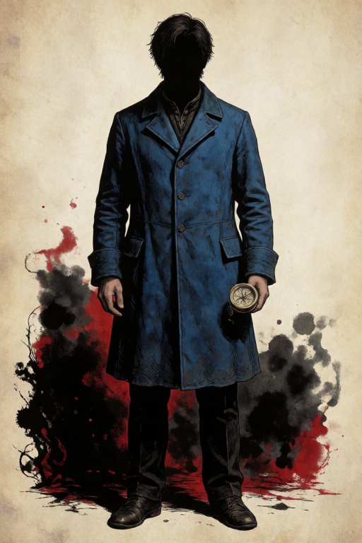

## STYLE-121 clean dreamcore surreal

Soft dreamy hills/cloud atmosphere consistent; surreal specificity weak

Known limitations: None recorded in this small cohort; not guaranteed


[이전 실험 대표 이미지](previews/STYLE-121_best.png) (historical)


## STYLE-122 retro airbrush future

Soft retro airbrush halo much clearer than hard rays/cel alternatives

Known limitations: FACE_READABILITY_FAILED


[이전 실험 대표 이미지](previews/STYLE-122_best.png) (historical)

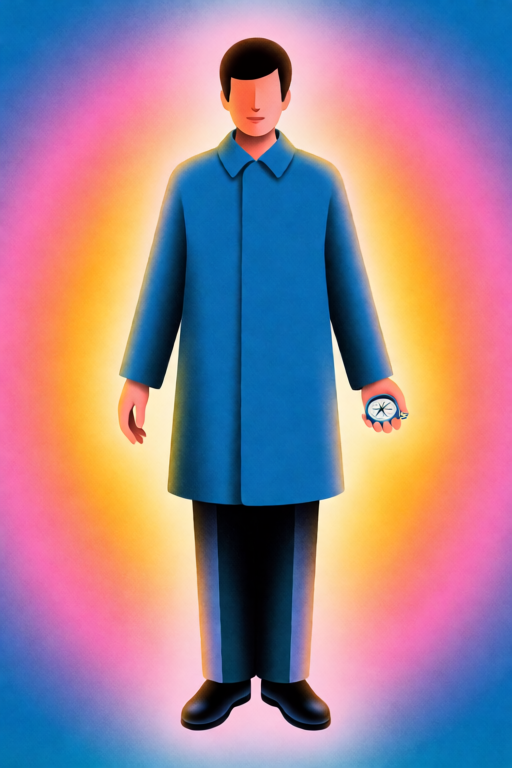

## STYLE-123 clay toy character

Tactile rounded clay toy volume and matte surfaces across all seeds

Known limitations: None recorded in this small cohort; not guaranteed


[이전 실험 대표 이미지](previews/STYLE-123_best.png) (historical)

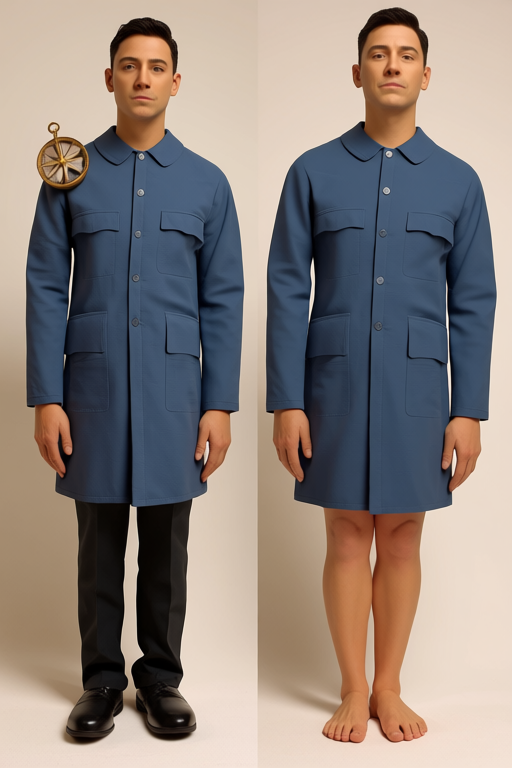

## STYLE-124 voxel diorama

Cubical voxel blocks clearly distinguish from triangular low-poly alternatives

Known limitations: CAMERA_VIEW_DRIFT


[이전 실험 대표 이미지](previews/STYLE-124_best.png) (historical)

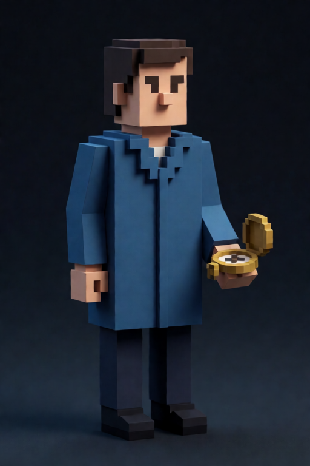

## Local routing checks

25 real offline route/compiler executions passed: all 23 resolved styles plus both purpose routes for flat_vector_editorial. Missing policy fails closed. These checks generated zero images. All 216 archived originals passed SHA-256 verification.

```powershell
assetpipe route --brief research/style_catalog/style_menu_v1/examples/retro_sci_fi_anime.json --output workspace/menu_route.json
```

Representative best/failure selections are editorial exemplars, not production approval. Run-record ZIP preserves all original JSON evidence. No game SOT has been rewritten.


Final local checks: pytest 332 passed / 1 skipped (missing local migration benchmark); git diff --check, assetpipe --help, Anima family offline check PASS. SOT binding and five conflict checks PASS. Data/recipe approval statuses remain historical; operational menu authorization binds explicit model intent without manufacturing Golden or Aseprite approval.
